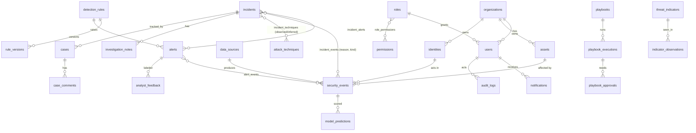

# SentinelX AI: architecture (Phase 1)

## System overview

```
Browser (React + Vite + TS)
   |  REST /api/v1  +  SSE/WebSocket (live events)
Spring Boot 3 backend (Java 21)
   |-- Spring Security: JWT, RBAC, deny by default       (Phase 2)
   |-- Ingestion pipeline: validate -> normalize -> persist -> detect -> correlate -> publish   (Phase 4)
   |-- Rules engine (deterministic)  +  optional analytics client   (Phases 4-5)
   |-- Audit, notifications, reporting                    (Phase 7)
   |            \
PostgreSQL 16  Redis 7        analytics-service (optional FastAPI + scikit-learn, Phase 5)
```

Design rules that apply everywhere:

- The platform works with no external AI key. The rules engine is the fallback when the analytics service or an LLM is unavailable.
- Event contents and threat feeds are untrusted data. They are rendered escaped and are never passed to an AI tool as instructions.
- Every tenant-owned table has `organization_id`. Queries must filter by the caller's organization.
- Demo mode labels all generated data as simulated (`is_synthetic` columns, `Simulated data` tags in the UI).
- Mapping and correlation records distinguish `OBSERVED` from `INFERRED`.
- Consequential response actions need a permission and an approval record. Demo connectors are mocks.

## Monorepo layout

```
sentinelx-ai/
  backend/            Spring Boot app, Flyway migrations, tests
  frontend/           React app, design tokens, app shell
  analytics-service/  optional FastAPI service (Phase 5)
  docs/               architecture and API notes
  .github/workflows/  CI
  docker-compose.yml  postgres, redis, backend, frontend
  .env.example        configuration template (no real secrets)
```

## Database relationships (migration `V1__core_schema.sql`)



Notable decisions:

- UUID primary keys, except `audit_logs` (bigserial, append-only through a trigger that rejects UPDATE and DELETE).
- Partial unique indexes deduplicate events (`dedupe_hash`) and open alerts (`dedupe_key`).
- Alert `confidence`, `severity`, and `risk_score` are separate columns by design.
- Suppression rules require `expires_at`.
- `ddl-auto: validate`: Flyway owns the schema.

## Roles (migration `V2__reference_roles_permissions.sql`)

| Role | Grants |
|---|---|
| ADMINISTRATOR | all 23 permissions |
| SECURITY_ANALYST | read and write alerts and incidents, intel, request playbooks, reports and export |
| INCIDENT_RESPONDER | read most data, approve and execute playbooks |
| READ_ONLY_VIEWER | read dashboards, alerts, incidents, assets, reports |

## Dashboard design plan

- Palette: deep navy background, cyan accent, red/orange/amber/teal severity scale used with a text label and a rail, never color alone. Light and dark themes share one token set (`frontend/src/index.css`).
- Type: IBM Plex Sans for interface text, IBM Plex Mono for identifiers and figures. Fonts are self-hosted through `@fontsource`, so there are no third-party font requests.
- Signature element: the severity rail on live-activity and table rows.
- Shell: left navigation grouped by task (Monitor, Investigate, Environment, Respond, Workspace, Platform, Admin), top bar with search, environment tag, simulator status, theme switch.
- Every page needs loading, empty, error, and success states. `EmptyState` exists now; the others arrive with each page.

## Phase status

| Phase | Scope | State |
|---|---|---|
| 1 | Architecture, repo, design system, core schema | Completed |
| 2 | Auth, RBAC model, reference roles & permissions (Flyway V2) | Completed |
| 3 | Dashboard data, live telemetry metrics, KPI streams | Completed |
| 4 | Ingestion pipeline, rule detectors, raw payload analysis | Completed |
| 5 | Anomaly detection, Isolation Forest ML models, threat intel | Completed |
| 6 | Attack graph topology, MITRE ATT&CK matrix navigator | Completed |
| 7 | SOAR playbooks, case management, reports, audit logging | Completed |
| 8 | Multi-channel dispatch, health telemetry, port 5158 deployment | Completed |
